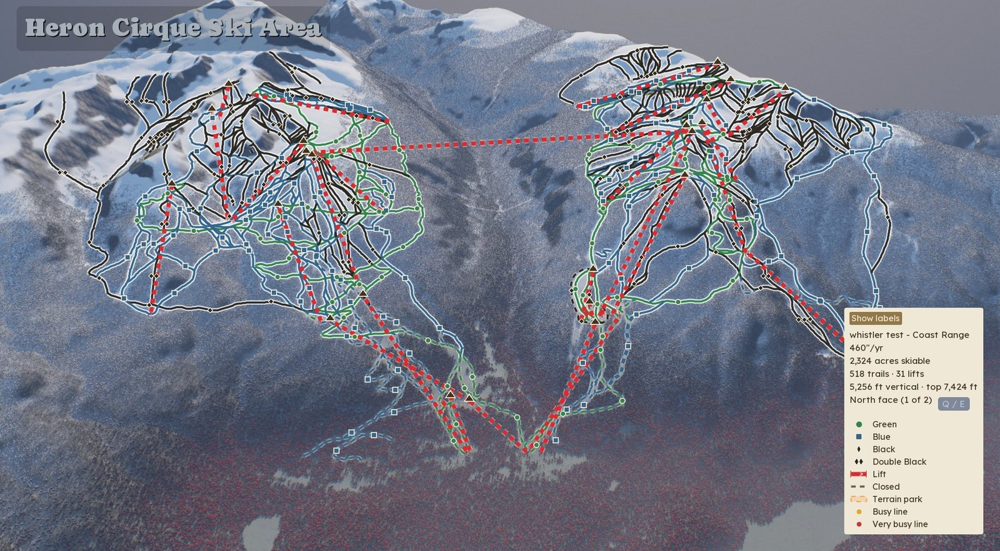
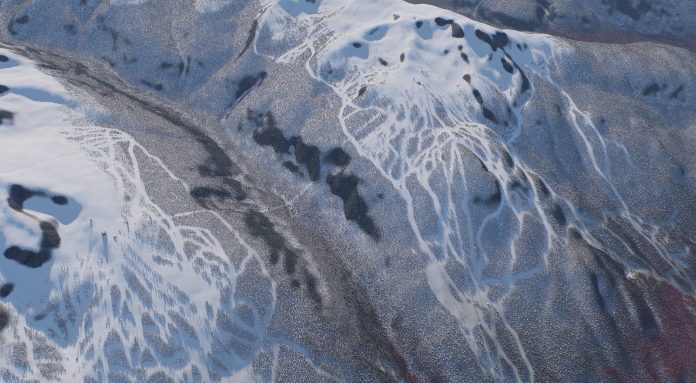
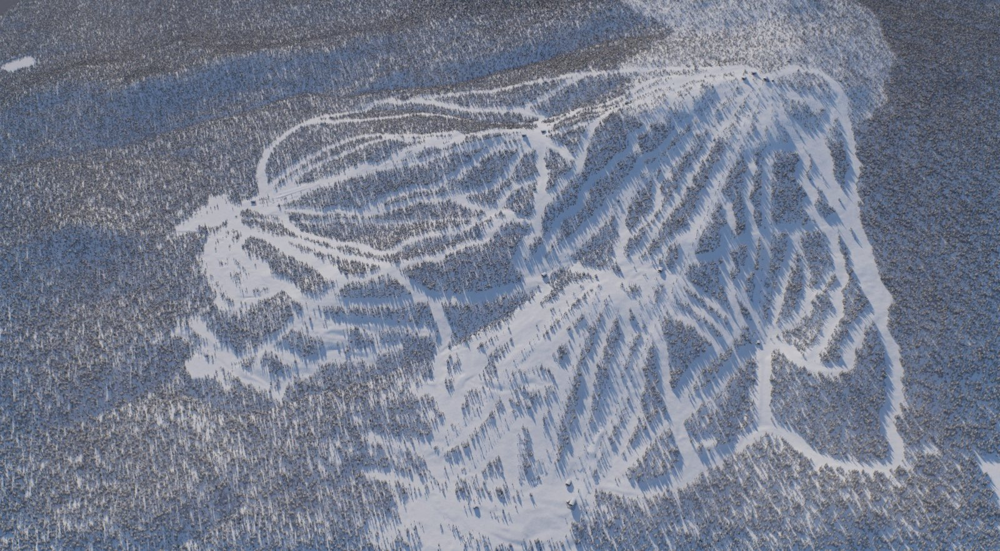
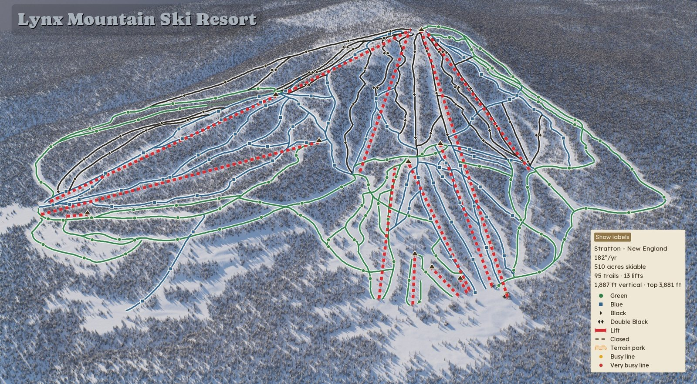
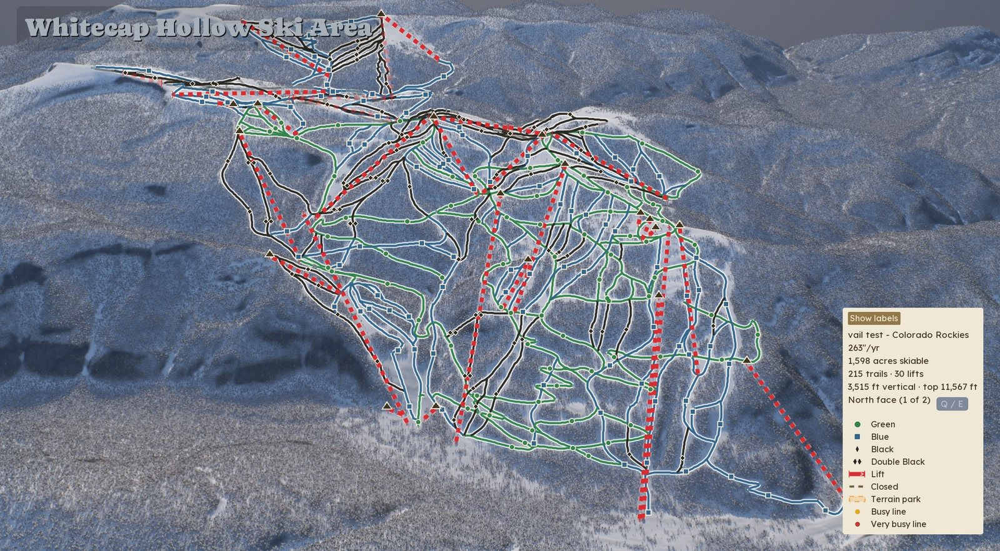
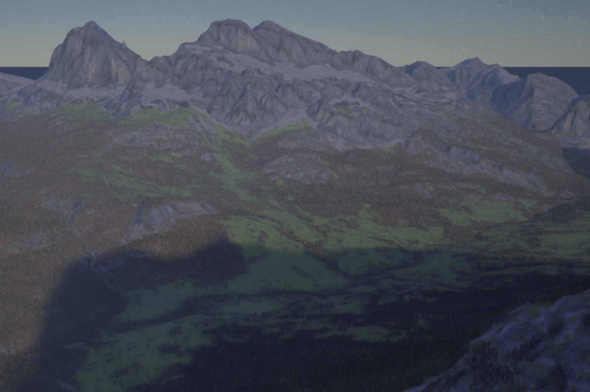
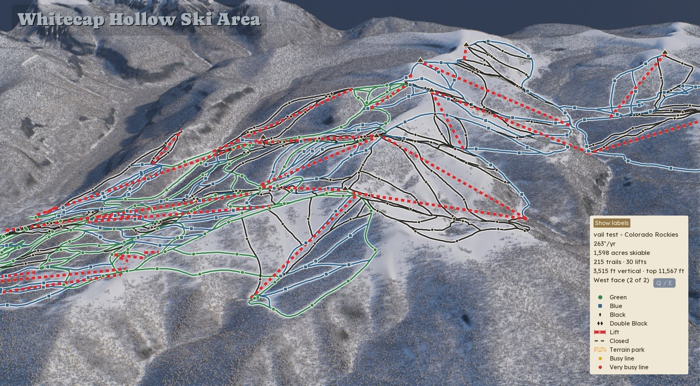

<div align="center">

# Ski-E-O Map Creator 1.8.1.dem

**Turn any real mountain into a playable map for Ski-E-O!**<br>
Real terrain, a forest that fits the region, and the ski area's real trails and lifts, built and installed in a
couple of minutes.

[](https://github.com/oofbyte/Skieo-Map-Creator/releases/latest)
[](https://github.com/oofbyte/Skieo-Map-Creator/releases)
[](#download-and-play)
[](LICENSE)



<sub>Whistler Blackcomb from OpenStreetMap: 518 trails and 31 lifts, in the game's own Ski Map.</sub>

</div>

Fan-made; not affiliated with or endorsed by the developers of Ski-E-O!.

> **Modified version.** This is a modified version of the original Ski-E-O Map Creator 1.8.1 by
> [oof](https://github.com/oofbyte/Skieo-Map-Creator). Many thanks to oof for creating this tool! Modified by lux.

## What it does

- **Any mountain on Earth.** Search a ski area, mountain or town, drag the square over it (3 to 20 km wide) and load
  the real elevation: USGS 10 m data in the US, about 30 m everywhere else.
- **Real trails and lifts.** Switch on **Real trails and lifts** and the ski area's runs and lifts from
  OpenStreetMap are built into the map, ready when you start a New Game, each run as wide as its real cut through
  the forest. Near the runs the forest follows the real tree cover, so open bowls stay open and glades stay wooded.
- **A forest that fits.** The tree species of the game's own maps of the region, mixed and grouped in stands the way
  they are there, with conifers near the summits, up to the treeline, and a tree limit for slower PCs.
- **Snow like the game's own maps.** Piles, banks and drifts build up through the winter.
- **3D preview.** Look the terrain over in 3D before you build it.
- **Installs itself.** The map shows up on the game's world map in its real region, with its real elevations and
  climate. **My Maps** reinstalls, removes or rebuilds your maps with the latest fixes.
- **Mod Library.** One-click extras for the game, [below](#mod-library).

## Screenshots

<table>
<tr>
<td width="50%"></td>
<td width="50%"></td>
</tr>
<tr>
<td align="center"><sub>Whistler Blackcomb in the game</sub></td>
<td align="center"><sub>Stratton, Vermont: every run cut into the forest</sub></td>
</tr>
<tr>
<td width="50%"></td>
<td width="50%"></td>
</tr>
<tr>
<td align="center"><sub>Stratton in the Ski Map: 95 trails, 13 lifts</sub></td>
<td align="center"><sub>Vail in the Ski Map: 215 trails, 30 lifts</sub></td>
</tr>
</table>

<table>
  <tr>
    <td width="60%"></td>
    <td width="40%"></td>
  </tr>
  <tr>
    <td><em>Cortina d'Ampezzo with real world trees without lifts</em></td>
    <td><em>The mighty Matterhorn on a 10 x 10 km terrain</em></td>
  </tr>
</table>



<p align="center"><sub>Vail from the west: the Back Bowls and Blue Sky Basin</sub></p>

## v1.8.1.dem
Based on the original 1.8.1.
### Recently changed
- **3D view: overlays.** Four overlays (Buildability, Slope difficulty, Trails & lifts, Trees) can be switched on in any combination, on top of each other and of the Terrain or
  Topo map surface:
- **Leave out real lifts and trails on the map.** Click a lift or a trail on the 2D map to leave it out of the build (it is
  shown at 10% opacity) and click again to take it back. What is left out is removed from the 3D view's Trails & lifts overlay
  and from the map that is built. **Tick all / Untick all** buttons above each list do all lifts or all trails at once. It is saved with the map, so Show restores it.
- **Show** on a saved map in My Maps loads everything the map was built with: position, size, rotation, name, biome,
  treeline, snow, valley, slope, treeline fade, tree count, height modifier and offset, and real trails and lifts and
  real tree cover when the map used them. It uses the cached elevation and tree cover, and the trails and lifts saved
  with the map, instead of downloading them again.

### What's new
- **Rotate the area.**
- **Sharper terrain in many countries.** New maps use the best national elevation survey where there is one,
  stitched across borders, in front of AWS Terrain Tiles. Failed downloads are retried three times, and only the tiles the window needs are fetched.
- **Real tree cover for the whole map for terrains without lifts** (switch under Your resort): trees grow where the satellite tree cover says
  they do, so meadows, bowls and burns stay open. It is downloaded once and reused for the same area.
- **Height modifier and height offset** for the terrain, recalculated when you let go of the slider.
- **More reliable trails and lifts.** One Overpass request for the whole area, a server for your region first, and
  other servers as backups. Rotated areas work too.
- **Footer.** Lists the elevation sources; "all sources and licences" opens the full list with each licence
  (`packaging/THIRD-PARTY.txt` updated).
- **No update check.** The "Check for updates" button is gone and this build never looks for updates.

## Elevation data by country

In these countries the terrain comes from the national elevation survey. Where a country has several, the finest
one that covers the spot is used. Everywhere else, and in any gaps, it comes from Terrain Tiles on AWS (~30 m).
Licences and credits are in [`packaging/THIRD-PARTY.txt`](packaging/THIRD-PARTY.txt).

| Country | Datasets | Provider |
|---|---|---|
| Australia | 5 m lidar DEM | Geoscience Australia |
| Austria | ALS terrain model 1 m | BEV |
| Canada | HRDEM 2 m; ArcticDEM-based HRDEM 2 m (north of ~60° N) | Natural Resources Canada |
| Czechia | DMR 5G 2 m | ČÚZK |
| Finland | Elevation model 2 m (needs your own API key) | National Land Survey of Finland |
| France | LiDAR HD 0.5 m; RGE ALTI 5 m | IGN |
| Germany (Bavaria only) | DGM1 1 m | Bayerische Vermessungsverwaltung |
| Iceland | IslandsDEM 10 m | Icelandic Institute of Natural History |
| Italy | South Tyrol DTM 2.5 m (South Tyrol only); TINITALY 10 m | Provincia autonoma di Bolzano; INGV |
| Japan | GSI elevation tiles 1 m / 5 m / 10 m | Geospatial Information Authority of Japan |
| New Zealand | 1 m lidar DEM; 8 m DEM | Toitū Te Whenua LINZ |
| Norway | National terrain model 1 m | Kartverket |
| Poland | NMT 1 m | GUGiK |
| Slovakia | DMR 5.0 1 m | ÚGKK SR |
| Spain | MDT05 5 m | IGN / CNIG |
| Sweden | Markhöjdmodell 1 m (needs your own Geotorget key and secret) | Lantmäteriet |
| Switzerland and Liechtenstein | swissALTI3D 2 m; swissALTIRegio 10 m (also ~100 km beyond the border) | swisstopo |
| United Kingdom (England, Scotland) | England: LIDAR Composite DTM 1 m; Scotland: public-sector LiDAR DTM 1 m | Environment Agency; Scottish Government |
| United States (incl. Puerto Rico, US Virgin Islands) | USGS Seamless 1 m (contiguous US); 3DEP 3 m / 10 m | USGS |

## Download and play

1. Download **SkiEO-Map-Creator.exe** from
   [Releases](https://github.com/oofbyte/Skieo-Map-Creator/releases/latest). It's one file, no install. Windows may
   warn because the exe isn't code-signed: click **More info**, then **Run anyway**.
2. Search a mountain or ski area, drag the square over it and press **Load Terrain**.
3. Look over the preview, name your resort, and switch on **Real trails and lifts** for a real ski area.
4. Press **Create Map**. It takes a minute or two; if the game is open, the map is installed as soon as you close it.
5. Start Ski-E-O!, choose **New Game** and pick your map in its region on the world map.

Needs Windows 10 or 11, Ski-E-O! installed through Steam, and an internet connection. No game files are included:
the Map Creator reads what it needs from your own copy of the game. What changed in each version:
[CHANGELOG.md](CHANGELOG.md).

## Mod Library

Extras for the game, installed and removed with one click in the Map Creator (close the game first):

| Mod | What it does |
|---|---|
| **Oof's Simple Cheat Menu** | **F6** in game: money, time up to 100x, weather and climate, reputation, guests, no accidents or breakdowns, build anywhere |
| **Oof's Anarchy** | **Ctrl+A** in game: build anywhere. Buildings and lifts ignore slopes, ground type, trees and rocks, and other buildings |
| **Oof's Speed Control** | Speed buttons from 1x to 100x under the game's own |
| **Oof's Alpine Buildings** | 50 new cabins, hotels and base lodges in the build menu |
| **Doppelmayr D-Line R2 Six** and **R2 Gondola** | Two new lifts in the build menu |

The in-game mods (the cheat menu, Anarchy and Speed Control) run on the [UE4SS](https://github.com/UE4SS-RE/RE-UE4SS)
mod loader: the Map Creator installs it if you don't have it, and removes it again with the last mod that needs it
(unless other mods use it).

Made a mod and want it in the Mod Library? See [docs/MODDING.md](docs/MODDING.md).

## If something goes wrong

- **The window stays empty.** The window is drawn by Microsoft Edge WebView2. When it can't start, the Map Creator
  tries once more with a fresh browser profile and graphics acceleration off, then says what went wrong. Usually
  WebView2 is damaged (tools that remove Microsoft Edge often leave it half removed): repair it in Windows Settings >
  Apps > Microsoft Edge WebView2 Runtime > Modify, or install it from
  [Microsoft](https://go.microsoft.com/fwlink/p/?LinkId=2124703).
- **The game closes the first time it starts after installing a map or a mod.** That can happen once: start it
  again.
- **A custom map has no trees after a game update.** The game drops every tree of a map with more than 1.5 million,
  and the Map Creator raises that limit in the game's exe. A game update puts the old exe back: close the game, open
  the Map Creator once, then start the game. Your maps need no rebuilding.
- **Anything else:** press **Copy diagnostics** at the bottom of the Map Creator and paste it into an
  [issue](https://github.com/oofbyte/Skieo-Map-Creator/issues). The log is
  `%LOCALAPPDATA%\SkiEO Map Creator\logs\creator.log`.

## Updates

This modified version does not check for updates and has no update button. Get new versions from Releases.

## Verify a download

Every release exe is built by GitHub Actions from the tagged source (`.github/workflows/release.yml`); nothing is
built or uploaded by hand. Three ways to check one:

1. **SHA-256**: compare with the hash on the release page and in its `SHA256SUMS.txt`:
   `certutil -hashfile SkiEO-Map-Creator.exe SHA256`
2. **Build attestation** (signed proof of which workflow run and commit built it), with the
   [GitHub CLI](https://cli.github.com): `gh attestation verify SkiEO-Map-Creator.exe --repo oofbyte/Skieo-Map-Creator`
3. **Compare with the source yourself**: check out the release tag, then
   ```
   py -3.12 -m pip install -r requirements.txt
   py -3.12 packaging\verify_exe.py SkiEO-Map-Creator.exe
   ```
   It opens the exe and checks every bundled file byte for byte and every app module as compiled code against the
   source, and lists everything else inside (Python and the libraries in `requirements.txt`).

## Privacy

What the app connects to: GitHub at each start (this repository's latest release, for updates), map tiles
(OpenStreetMap, OpenTopoMap, Esri World Imagery), place search (Photon, Nominatim), elevation data (USGS 3DEP, AWS
Terrain Tiles) and, with **Real trails and lifts** on, the OpenStreetMap ski data (Overpass API) and tree canopy
heights (Meta / WRI, AWS Open Data). retoc downloads the Oodle compression library on first use. No accounts, no
telemetry. It writes to `%LOCALAPPDATA%\SkiEO Map Creator`, the game's `Content\Paks\~mods` folder and, for the
in-game mods, `Binaries\Win64\ue4ss`; never to your saves.

## For developers

How the maps are built, running from source, building the exe, the code layout, the tests and releasing:
[docs/DEVELOPMENT.md](docs/DEVELOPMENT.md).

## License

MIT, see [LICENSE](LICENSE). Bundled third-party software keeps its own license; credits for the libraries, fonts and
data sources are in `packaging/THIRD-PARTY.txt`.
