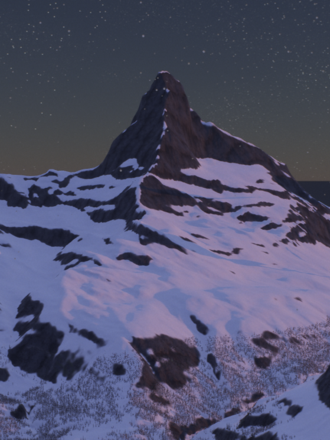

# Ski-E-O Map Creator

A standalone Windows app that turns any real-world mountain into a playable map for **Ski-E-O!**. Pick a square on
the map, and it downloads the real elevation, builds a complete map (terrain, forests, snow, preview, starting
base) and installs it into the game. It needs no Unreal Engine, and no game files are included: it reads what it
needs from the player's own installed copy of the game.

Fan-made; not affiliated with or endorsed by the developers of Ski-E-O!.

> **Modified version.** This is a modified version of the original Ski-E-O Map Creator 1.7.6 by
> [oof](https://github.com/oofbyte/Skieo-Map-Creator). Many thanks to oof for creating this tool! Modified by lux.

<table>
  <tr>
    <td width="60%"></td>
    <td width="40%"></td>
  </tr>
  <tr>
    <td><em>Cortina d'Ampezzo with real world trees without lifts</em></td>
    <td><em>The mighty Matterhorn on a 10 x 10 km terrain</em></td>
  </tr>
</table>

## What is different in this version (1.7.6.dem)

Everything below is added on top of the original 1.7.6:

- **Rotate the area.**
- **Sharper terrain in many countries.** New maps use the best national elevation survey where there is one,
  stitched across borders, in front of AWS Terrain Tiles. Failed downloads are retried three times, and only the tiles the window needs are fetched.
- **Real tree cover for the whole map for terrains without lifts** (switch under Your resort): trees grow where the satellite tree cover says
  they do, so meadows, bowls and burns stay open. It is downloaded once and reused for the same area.
- **Height modifier and height offset** for the terrain, recalculated when you let go of the slider.
- **More reliable trails and lifts.** One Overpass request for the whole area, a server for your region first, and
  other servers as backups. Rotated areas work too.
- **Footer.** Lists the elevation sources; "all sources and licences" opens the full list with each licence
  (`packaging/THIRD-PARTY.txt` updated).
- **No update check.** The "Check for updates" button is gone and this build never looks for updates.

Details per change: [CHANGELOG.md](CHANGELOG.md).

## Download

Get `SkiEO-Map-Creator.exe` from [Releases](../../releases/latest). It's one file, no install. Windows may warn
because the exe is unsigned: click **More info**, then **Run anyway**. Changes: [CHANGELOG.md](CHANGELOG.md).

Needs Windows 10/11 and Ski-E-O! installed through Steam.

**Updates:** this modified version does not check for updates and has no update button. Get new versions from
Releases.

**If the window stays empty:** the window is drawn by Microsoft Edge WebView2. When it can't start, the Map Creator
tries once more with a fresh browser profile and graphics acceleration off, then says what went wrong. Usually
WebView2 is damaged (tools that remove Microsoft Edge often leave it half removed): repair it in Windows Settings >
Apps > Microsoft Edge WebView2 Runtime > Modify, or install it from
[Microsoft](https://go.microsoft.com/fwlink/p/?LinkId=2124703). The log is `%LOCALAPPDATA%\SkiEO Map Creator\logs\creator.log`.

## Verify a download

Every release exe is built by GitHub Actions from the tagged source (`.github/workflows/release.yml`); nothing is
built or uploaded by hand. Three ways to check one:

1. **SHA-256**: compare with the hash on the release page and in its `SHA256SUMS.txt`:
   `certutil -hashfile SkiEO-Map-Creator.exe SHA256`
2. **Build attestation** (signed proof of which workflow run and commit built it), with the
   [GitHub CLI](https://cli.github.com): `gh attestation verify SkiEO-Map-Creator.exe --repo oofbyte/Skieo-Map-Creator`
3. **Compare with the source yourself**: check out the release tag, then
   ```
   py -3.12 -m pip install -r requirements.txt
   py -3.12 packaging\verify_exe.py SkiEO-Map-Creator.exe
   ```
   It opens the exe and checks every bundled file byte for byte and every app module as compiled code against the
   source, and lists everything else inside (Python and the libraries in `requirements.txt`).

What the app connects to: map tiles
(OpenStreetMap, OpenTopoMap), place search (Photon, Nominatim), elevation
data (national elevation surveys, USGS 3DEP, AWS Terrain Tiles) and, with **Real trails and lifts** on, the OpenStreetMap ski data (Overpass API)
and tree canopy heights (Meta / WRI, AWS Open Data). retoc downloads the Oodle compression library on first use. No accounts, no
telemetry. It writes to `%LOCALAPPDATA%\SkiEO Map Creator` and the game's `Content\Paks\~mods` folder, never to
saves.

## How it works

1. **Elevation**: the best national survey where there is one, USGS 3DEP 1/3 arc-second (~10 m) in the US, AWS
   Terrain Tiles (~30 m) as the fill and elsewhere (`dem.py`). It is resampled onto the game's 2017 x 2017 landscape grid on a local transverse Mercator projection
   (`geo.py`).
2. **Game data**: `gamedata.py` uses retoc to extract a donor map (Mad River Glen) and a few assets from the
   player's game into a cache, and dry-runs every writer on them before the first build.
3. **Build** (`builder.py`): the donor map is copied, and these parts are rewritten:
   - **Heights and scale:** landscape heights and all their mip levels (made the way Unreal makes them), edge-normal
     rings and grid scale (`engine/terrain_write.py`, `engine/provider_write.py`); component bounds and collision;
     the map frame (size, height scale); and the edge wall, whose edge the terrain is fitted to (`engine/map_frame.py`).
   - **Forest:** in the game's baked-obstacle format, with the biome's own tree species (`trees.py`, `biomes.py`).
   - **Snow piles:** written from a cooked template mesh (`shells.py`, `data/shell_template.*`).
   - **Everything else:** terrain material overrides (`engine/material_params.py`), the height texture, the map
     preview, the starting save (ticket office on the base area), and the map list entry. Every renamed string keeps
     its length.
   - **Real trails and lifts** (optional, `resort.py`): the ski area's OpenStreetMap lifts and pistes become the
     game's own lift and trail records in the starting save (read and written with `engine/gvas_tree.py`, record
     layouts from `data/resort_templates.bin`), the forest leaves their corridors clear, and the map list entry's
     `InitialSave` makes New Game start from that save. Glades are left out: the ones OSM marks, and runs under tree
     canopy with no cleared corridor in the satellite canopy heights (`canopy.py`). A run drawn twice in OSM is built
     once. Within 300 m of the runs, glades and lifts the forest follows the real tree cover from the same canopy
     heights (`resort.tree_cover`), so open bowls and meadows stay open.
4. **Pack and install**: retoc `to-zen` packs a `ZZZ_MC_<name>_P` pak. `install.py` adds the map to the game's
   map list (`ZZZ_Registry_P`) and copies it into `Content/Paks/~mods`.

The window is a local web UI (`web/`: Leaflet map, three.js 3D preview) shown by pywebview / WebView2. `server.py`
serves it on 127.0.0.1, with a token-protected tile proxy on its own port.

## Run from source

Windows 10/11, Python 3.12, Ski-E-O! installed through Steam.

```
py -3.12 -m venv .venv
.venv\Scripts\python -m pip install -r requirements.txt
.venv\Scripts\python run.py
```

## Build the exe

```
packaging\build.bat
```

This makes `dist\SkiEO-Map-Creator.exe`, a single file that bundles `web/`, `data/` and `tools/retoc.exe`.

## Layout

| Path | What |
|---|---|
| `skieo_creator/` | app: `main.py` (window), `api.py` (calls from the page), `builder.py`, `trees.py`, `shells.py`, `dem.py`, `install.py` ... |
| `skieo_creator/engine/` | writers for the cooked map data (heightmaps, providers, bounds, collision, frame, headers, materials) |
| `web/` | the UI (HTML / CSS / JS) and vendored Leaflet + three.js |
| `data/` | the cooked snow-shell template; `resort_templates.bin`, blank lift / trail save records (from `packaging/make_resort_templates.py`) |
| `tools/` | retoc.exe (MIT, https://github.com/trumank/retoc) |
| `packaging/` | PyInstaller spec, build script, icon, version info, credits (`THIRD-PARTY.txt`), `verify_exe.py` |
| `tests/ui_drive.py` | scripted UI sessions with screenshots (`search`, `3d`, `3d-offline`, `numbox`, `osm`, ...) |
| `tests/test_resort.py` | self-check of the trail and lift import rules on made-up data |
| `tests/test_dem.py` | self-check of reading where the USGS elevation image really is (its GeoTIFF tags) |
| `tests/test_update.py` | self-check of the self-update (release lookup, checksums, swapping the exe) without the network |
| `tests/test_install.py` | self-check of the map list entries (never a tutorial map, the once-only rebuild of older ones) |
| `tests/test_main.py` | self-check of the empty-window guard (a second try, then a message) with a stand-in window |
| `.github/workflows/release.yml` | builds, checks, hashes and attests the exe and attaches it to each release |

## Releasing

1. Bump `VERSION` in `skieo_creator/__init__.py` and the versions in `packaging/version_info.txt`, and add a
   `## vX.Y.Z` section to `CHANGELOG.md`.
2. On GitHub: **Releases → Draft a new release**, create the tag `vX.Y.Z`, and publish. The description can stay
   empty.
3. The workflow builds the exe from that tag, checks it against the source, and attaches it and `SHA256SUMS.txt` to
   the release, with the notes from `CHANGELOG.md`. It stops if the tag doesn't match the versions in step 1.

## License

MIT, see [LICENSE](LICENSE). Bundled third-party software keeps its own license; credits for the libraries, fonts and
data sources are in `packaging/THIRD-PARTY.txt`.
